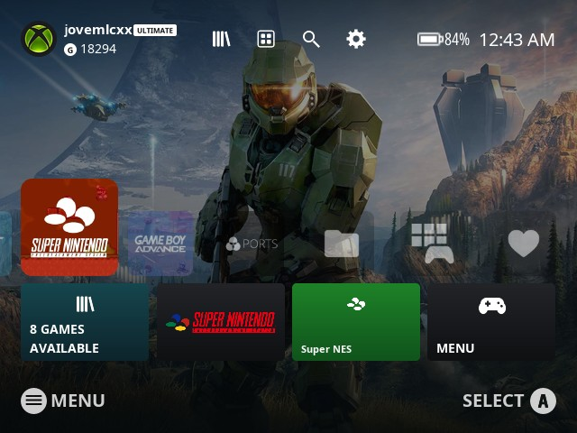
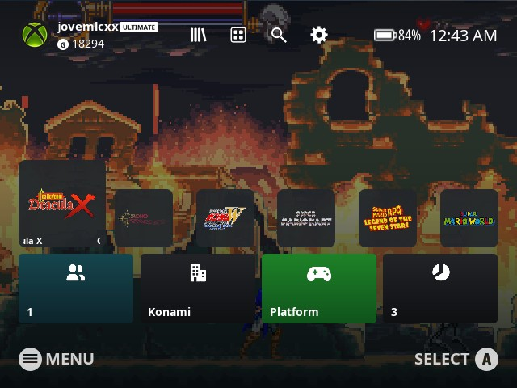
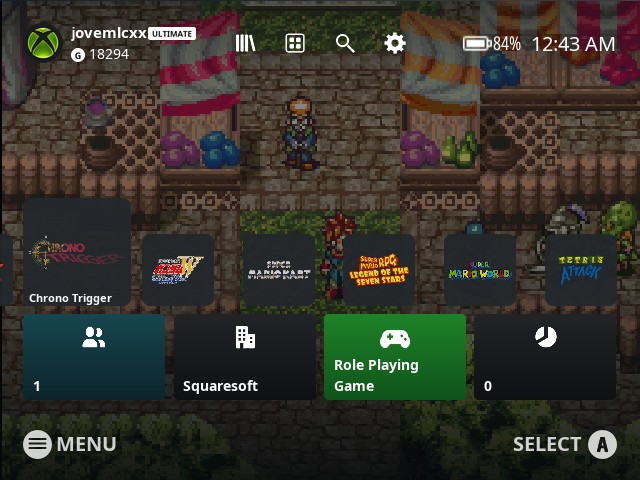
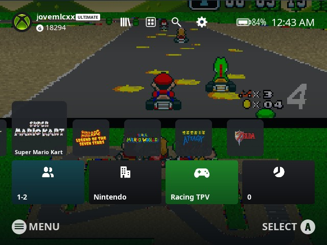

# es-theme-xboxseriesxs-fcamod

**EN** · [BR](README.pt-BR.md)

 [](LICENSE) [](https://www.reddit.com/user/jovemlcxx/) [](https://ko-fi.com/jovemlcxx)

Xbox Series X|S–style theme for **EmulationStation-fcamod** on the **R36S** and clones (ArkOS family, 640×480): the Xbox home with its profile, top bar, a row of tiles where the selected one grows, and four info tiles under it.

<p align="center">
   <br>
   
</p>

[Install](#install) · [Theme](#the-theme) · [Options](#options) · [Wallpapers](#wallpapers) · [Compatibility](#compatibility) · [Customize](#customize)

## Install

1. Download this repository (**Code → Download ZIP**) or clone it.
2. Copy the folder to the themes folder of your device: `/roms/themes/` (the `themes` folder of the games partition) or `~/.emulationstation/themes/`. It must be named `es-theme-xboxseriesxs-fcamod` (or `es-theme-xboxseriesxs-fcamod-main` from the ZIP). When updating, delete the old folder first.
3. **START → UI Settings → Theme Set → es-theme-xboxseriesxs-fcamod**. The options are in **UI Settings → Theme Configuration**.

Over SSH:

```
scp -r es-theme-xboxseriesxs-fcamod ark@<console-ip>:/roms/themes/
```

Leave the frontend's **Gamelist View Style** and **Grid Size** on **automatic**: other values replace the theme's game list layout.

## The theme

- **System screen:** the Xbox home: profile (name, ULTIMATE badge and gamerscore, with the Xbox logo as the photo) at the top left, the library / apps / search / settings icons in the middle, battery and clock at the right. The row of system tiles starts with the selected one, which **expands up and to the sides** over the next ones; under it four tiles: the system's game count, its logo, its name and the menu.
- **Game list:** the same row with each game's **wheel / marquee** fitted inside a rounded tile (never cut or stretched; games without one show a controller), over the game's own screenshot, darkened. The four tiles under it show players, developer, genre and times played.
- **Background:** your own image or animated video, 20 wallpaper slots; the default is the Halo Infinite key art.
- **Button legend** (on by default, can be turned off): Start (menu) and confirm buttons at the bottom, in Nintendo/Xbox (A B X Y) or PlayStation (○ ✕ △ □) style.
- Dark and light settings menus, including the on-screen keyboard text boxes.
- **26 languages** (same as the XMB and PS5 themes): every option follows the frontend language.
- Navigation sounds taken from the Xbox interface's own tick. For now the theme is focused on the **R36S, 4:3 (640×480)**.

## Options

| Option | Choices (default first) | Notes |
|---|---|---|
| Aspect Ratio | 4:3 | 640×480 screens (R36S, RG351MP...). |
| Wallpaper | 1 to 20 | Only `1` is included, see [Wallpapers](#wallpapers). |
| Color Scheme | Dark / Light | Settings menu and on-screen keyboard. |
| Background Video | Enabled / Disabled | Disable it on slow devices; the wallpaper image is used instead. |
| Button Icons | Nintendo / Xbox, PlayStation | PlayStation follows the button position: A = ○, B = ✕. |
| Confirm Button (A/B) | A / B | Use **B** if you swapped A/B in the system (dArkOSen ships swapped). |
| Button Legend | Enabled / Disabled | The Start / confirm legend at the bottom. |

## Wallpapers

Each of the 20 slots is an **image** (`bg_<n>.png`) and, optionally, an **animated video** (`bg_<n>.mp4`) that plays on top of it. The image is also the fallback while the video loads or when the video is disabled.

1. Make it **640×480**: the theme stretches it to the whole screen.
2. Video (optional): 640×480 `.mp4`, short (10 to 30 s, it loops), no sound, 30 fps, under ~20 MB.
3. Name both files with a free slot number from 2 to 20 (e.g. `bg_2.png` and `bg_2.mp4`), copy them to `_inc/background/` and pick the number in **Theme Configuration → Wallpaper**.

```
ffmpeg -i input.mp4 -vf "scale=640:480:force_original_aspect_ratio=increase,crop=640:480" -an -r 30 -c:v libx264 -crf 23 -movflags +faststart bg_2.mp4
ffmpeg -i bg_2.mp4 -frames:v 1 bg_2.png
```

Keep a copy of your `bg_*` files before updating the theme.

## Compatibility

What has actually been tested, and how:

| | Theme | Platforms with their own tile and logo |
|---|---|---|
| dArkOS4Clone | ✅ | 135 of 135 |
| ArkOS | 🧪 | 136 of 136 |
| arkos4clone | 🧪 | 136 of 136 |
| dArkOS | 🧪 | 129 of 129 |
| dArkOSRE-R36 | 🧪 | 126 of 126 |
| dArkOSen | 🧪 | 127 of 127 |
| Batocera, Knulli, EmuELEC, ArchR, muOS | not tested | – |

- ✅ **Validated on real hardware** (R36S): system screen, game list, options, button icons, legend and 12 h / 24 h clock.
- 🧪 **Checked offline, waiting for feedback:** the EmulationStation of that system (its binary, and the source where available) knows every element and property the theme uses, and every platform in its `es_systems.cfg` has a tile and a logo.

About 30 platforms per system have no white emblem of their own and show a generic controller one; platforms the theme does not know show their name instead of a tile.

**Help test your system:** tell me your system, its version and what looks wrong, by [opening an issue](https://github.com/jovemlcxx/es-theme-xboxseriesxs-fcamod/issues) or [on Reddit](https://www.reddit.com/user/jovemlcxx/) (u/jovemlcxx).

## Customize

Files are named after the system's `<theme>` entry in `es_systems.cfg` (e.g. `snes`, `megadrive`), not the ROM folder. All paths are inside `_inc/`.

| What | Where | Size |
|---|---|---|
| System tile | `systems/icons/<theme>.png` | square, 256×256 |
| System logo (bottom tile) | `systems/marquees/<theme>.png` | any, transparent |
| System emblem (green tile) | `systems/logos/<theme>.png` | square, white, 96×96 |
| Wallpapers | `background/bg_<n>.png` · `.mp4` | 640×480 |
| Profile picture | `images/avatar.png` | square, 40×40 or more |
| Profile name and gamerscore | `profileName`, `profileScore` in `theme.xml` | text |
| Colors (menus) | `colors/dark.xml`, `light.xml` | |
| Translations | `lang/<code>.xml` | |

The game tiles use each game's **marquee** (pick **Marquee** or **Wheel** in the scraper; both are saved as the marquee) and the background its **image**. Layout is in `aspect-ratio-4-3.xml`; English texts are the `variables` at the top of `theme.xml` (fcamod stops reading `variables` blocks at the first one of another language, so each translation is its own file).

Known limits of fcamod that a theme cannot change: no per-game data on the system screen (so the tiles under the row show the system's own data), no play time (the game list shows times played), rounded corners are drawn into the images, and stock fcamod only plays the navigation, launch and back sounds.

## Credits and license

**Design reference:** the Xbox Series X|S home screen. Not affiliated with or endorsed by Microsoft; Xbox and its symbols are trademarks of Microsoft. The default wallpaper is Halo Infinite key art (© Microsoft / Xbox Game Studios / 343 Industries). System logos and trademarks belong to their respective owners.

The system tiles, logos and emblems come from [ps5-menu-es-de](https://github.com/InitialDin/ps5-menu-es-de) by InitialDin (system icons from [Siddy212's Canvas](https://github.com/Siddy212/canvas-es-de)) and keep its CC BY-NC-SA license. Button icons from the [XMB theme](https://github.com/jovemlcxx/es-theme-xmb-fcamod). Font: Noto Sans (SIL Open Font License 1.1).

**License:** [CC BY-NC-SA 4.0](LICENSE). Free: selling it, alone or bundled with devices, SD cards or images, is not allowed.

**Support:** if this theme is useful to you, you can support my work on [Ko-fi](https://ko-fi.com/jovemlcxx). Thank you! ☕

[](https://ko-fi.com/jovemlcxx)
