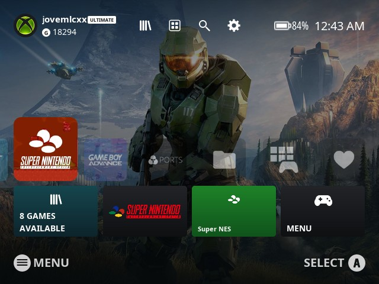
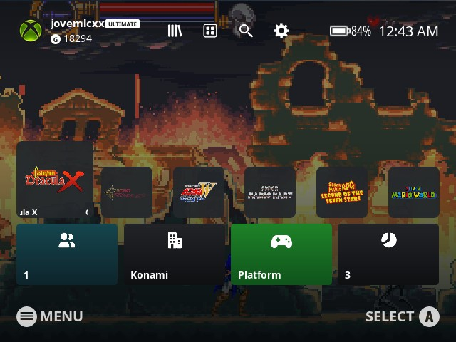
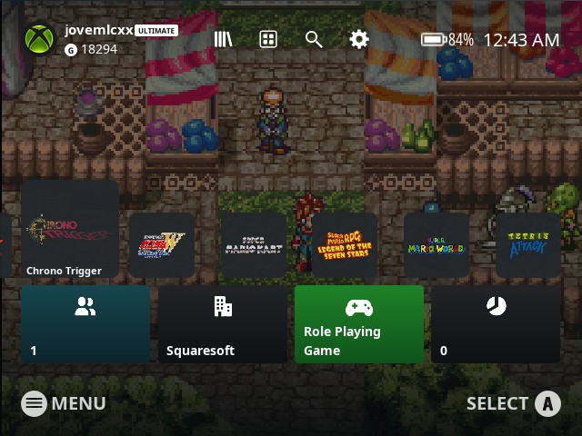
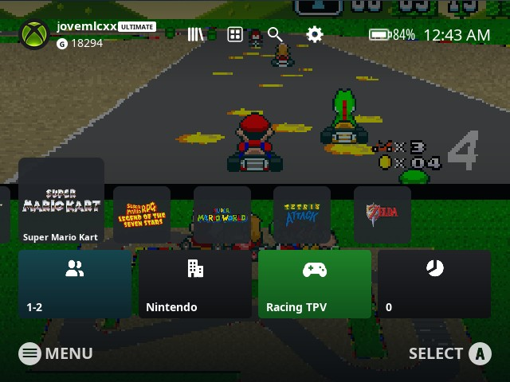

# es-theme-xboxseriesxs-fcamod

[EN](README.md) · **BR**

 [](LICENSE) [](https://www.reddit.com/user/jovemlcxx/) [](https://ko-fi.com/jovemlcxx)

Tema no estilo do Xbox Series X|S para o **EmulationStation-fcamod** no **R36S** e clones (família ArkOS, 640×480): a tela inicial do Xbox com perfil, barra do topo, uma fileira de blocos em que o selecionado cresce e quatro blocos de informação embaixo.

<p align="center">
   <br>
   
</p>

[Instalação](#instalação) · [Tema](#o-tema) · [Opções](#opções) · [Papéis de parede](#papéis-de-parede) · [Compatibilidade](#compatibilidade) · [Personalizar](#personalizar)

## Instalação

1. Baixe este repositório (**Code → Download ZIP**) ou clone-o.
2. Copie a pasta para a pasta de temas do aparelho: `/roms/themes/` (a pasta `themes` da partição de jogos) ou `~/.emulationstation/themes/`. Ela deve se chamar `es-theme-xboxseriesxs-fcamod` (ou `es-theme-xboxseriesxs-fcamod-main`, vinda do ZIP). Ao atualizar, apague a pasta antiga antes.
3. **START → CONFIGURAR INTERFACE → TEMA → es-theme-xboxseriesxs-fcamod**. As opções ficam em **CONFIGURAR INTERFACE → CONFIGURAÇÕES DE TEMA**.

Por SSH:

```
scp -r es-theme-xboxseriesxs-fcamod ark@<ip-do-console>:/roms/themes/
```

Deixe o **MODO DE VISUALIZAÇÃO, LISTA DE JOGO** e o **TAMANHO DA GRADE** do frontend em **automático**: outros valores substituem o layout da lista de jogos do tema.

## O tema

- **Tela de sistemas:** a tela inicial do Xbox: perfil (nome, selo ULTIMATE e gamerscore, com o logo do Xbox como foto) no canto superior esquerdo, os ícones de biblioteca / apps / busca / configurações no meio, bateria e relógio à direita. A fileira de blocos de sistema começa pelo selecionado, que **cresce para cima e para os lados** sobre os próximos; embaixo, quatro blocos: o número de jogos do sistema, o logo, o nome e o menu.
- **Lista de jogos:** a mesma fileira, com o **wheel / marquee** de cada jogo dentro de um bloco arredondado (sem cortar nem esticar; jogos sem ele mostram um controle), sobre o screenshot do próprio jogo, escurecido. Os quatro blocos embaixo mostram jogadores, desenvolvedor, gênero e vezes jogado.
- **Fundo:** sua própria imagem ou vídeo animado, 20 espaços de papel de parede; o padrão é a arte do Halo Infinite.
- **Legenda dos botões** (ativada por padrão, dá para desativar): Start (menu) e o botão de confirmar no rodapé, no estilo Nintendo/Xbox (A B X Y) ou PlayStation (○ ✕ △ □).
- Menus de configuração escuro e claro, inclusive as caixas de texto do teclado na tela.
- **26 idiomas** (os mesmos dos temas XMB e PS5): todas as opções seguem o idioma do frontend.
- Sons de navegação tirados do próprio tique da interface do Xbox. Por enquanto o tema é focado no **R36S, 4:3 (640×480)**.

## Opções

| Opção | Escolhas (padrão primeiro) | Observações |
|---|---|---|
| Proporção de Tela | 4:3 | Telas 640×480 (R36S, RG351MP...). |
| Papel de Parede | 1 a 20 | Só o `1` vem incluído, veja [Papéis de parede](#papéis-de-parede). |
| Esquema de Cores | Escuro / Claro | Menu de configurações e teclado na tela. |
| Vídeo de Fundo | Ativado / Desativado | Desative em aparelhos lentos; a imagem do papel de parede é usada no lugar. |
| Ícones dos Botões | Nintendo / Xbox, PlayStation | O PlayStation segue a posição dos botões: A = ○, B = ✕. |
| Botão de Confirmar (A/B) | A / B | Use **B** se você inverteu A/B no sistema (o dArkOSen já vem invertido). |
| Legenda dos Botões | Ativado / Desativado | A legenda de Start / confirmar no rodapé. |

## Papéis de parede

Cada um dos 20 espaços é uma **imagem** (`bg_<n>.png`) e, opcionalmente, um **vídeo animado** (`bg_<n>.mp4`) que toca por cima dela. A imagem também aparece enquanto o vídeo carrega ou quando o vídeo está desativado.

1. Faça em **640×480**: o tema estica o papel de parede para a tela inteira.
2. Vídeo (opcional): `.mp4` 640×480, curto (10 a 30 s, ele repete), sem som, 30 fps, abaixo de ~20 MB.
3. Dê aos dois arquivos o número de um espaço livre de 2 a 20 (por exemplo `bg_2.png` e `bg_2.mp4`), copie para `_inc/background/` e escolha o número em **CONFIGURAÇÕES DE TEMA → Papel de Parede**.

```
ffmpeg -i entrada.mp4 -vf "scale=640:480:force_original_aspect_ratio=increase,crop=640:480" -an -r 30 -c:v libx264 -crf 23 -movflags +faststart bg_2.mp4
ffmpeg -i bg_2.mp4 -frames:v 1 bg_2.png
```

Guarde uma cópia dos seus arquivos `bg_*` antes de atualizar o tema.

## Compatibilidade

O que foi realmente testado, e como:

| | Tema | Plataformas com bloco e logo próprios |
|---|---|---|
| dArkOS4Clone | ✅ | 135 de 135 |
| ArkOS | 🧪 | 136 de 136 |
| arkos4clone | 🧪 | 136 de 136 |
| dArkOS | 🧪 | 129 de 129 |
| dArkOSRE-R36 | 🧪 | 126 de 126 |
| dArkOSen | 🧪 | 127 de 127 |
| Batocera, Knulli, EmuELEC, ArchR, muOS | não testado | – |

- ✅ **Validado no aparelho** (R36S): tela de sistemas, lista de jogos, opções, ícones dos botões, legenda e relógio de 12 h / 24 h.
- 🧪 **Verificado offline, aguardando retorno:** o EmulationStation desse sistema (o binário e, quando disponível, o código-fonte) conhece todos os elementos e propriedades que o tema usa, e todas as plataformas do `es_systems.cfg` dele têm bloco e logo.

Cerca de 30 plataformas por sistema não têm emblema branco próprio e mostram um emblema genérico de controle; plataformas que o tema não conhece mostram o nome no lugar do bloco.

**Ajude a testar o seu sistema:** me conte qual é o sistema, a versão e o que parece errado, [abrindo uma issue](https://github.com/jovemlcxx/es-theme-xboxseriesxs-fcamod/issues) ou [pelo Reddit](https://www.reddit.com/user/jovemlcxx/) (u/jovemlcxx).

## Personalizar

Os arquivos levam o nome de tema do sistema (a tag `<theme>` do `es_systems.cfg`, por exemplo `snes`, `megadrive`), não o da pasta de ROMs. Todos os caminhos ficam dentro de `_inc/`.

| O quê | Onde | Tamanho |
|---|---|---|
| Bloco do sistema | `systems/icons/<tema>.png` | quadrado, 256×256 |
| Logo do sistema (bloco de baixo) | `systems/marquees/<tema>.png` | qualquer, transparente |
| Emblema do sistema (bloco verde) | `systems/logos/<tema>.png` | quadrado, branco, 96×96 |
| Papéis de parede | `background/bg_<n>.png` · `.mp4` | 640×480 |
| Foto do perfil | `images/avatar.png` | quadrada, 40×40 ou mais |
| Nome e gamerscore do perfil | `profileName`, `profileScore` no `theme.xml` | texto |
| Cores (menus) | `colors/dark.xml`, `light.xml` | |
| Traduções | `lang/<código>.xml` | |

Os blocos dos jogos usam o **marquee** de cada jogo (escolha **Marquee** ou **Wheel** no scraper; os dois são salvos como marquee) e o fundo usa a **image**. O layout fica em `aspect-ratio-4-3.xml`; os textos em inglês são as `variables` do topo do `theme.xml` (o fcamod para de ler os blocos `variables` no primeiro de outro idioma, por isso cada tradução é um arquivo próprio).

Limites do fcamod que um tema não consegue mudar: a tela de sistemas não tem dados dos jogos (por isso os blocos de baixo mostram os dados do próprio sistema), não existe tempo de jogo (a lista de jogos mostra vezes jogado), os cantos arredondados são desenhados nas imagens e o fcamod padrão só toca os sons de navegação, de abrir jogo e de voltar.

## Créditos e licença

**Referência de design:** a tela inicial do Xbox Series X|S. Sem afiliação nem endosso da Microsoft; Xbox e seus símbolos são marcas da Microsoft. O papel de parede padrão é a arte do Halo Infinite (© Microsoft / Xbox Game Studios / 343 Industries). Logos de sistemas e marcas pertencem aos seus donos.

Os blocos, logos e emblemas dos sistemas vêm do [ps5-menu-es-de](https://github.com/InitialDin/ps5-menu-es-de), de InitialDin (ícones de sistema do [Canvas, de Siddy212](https://github.com/Siddy212/canvas-es-de)) e mantêm a licença CC BY-NC-SA dele. Ícones dos botões do [tema XMB](https://github.com/jovemlcxx/es-theme-xmb-fcamod). Fonte: Noto Sans (SIL Open Font License 1.1).

**Licença:** [CC BY-NC-SA 4.0](LICENSE). Gratuito: é proibido vendê-lo, sozinho ou junto com aparelhos, cartões SD ou imagens.

**Apoio:** se este tema for útil para você, pode apoiar meu trabalho no [Ko-fi](https://ko-fi.com/jovemlcxx). Obrigado! ☕

[](https://ko-fi.com/jovemlcxx)
